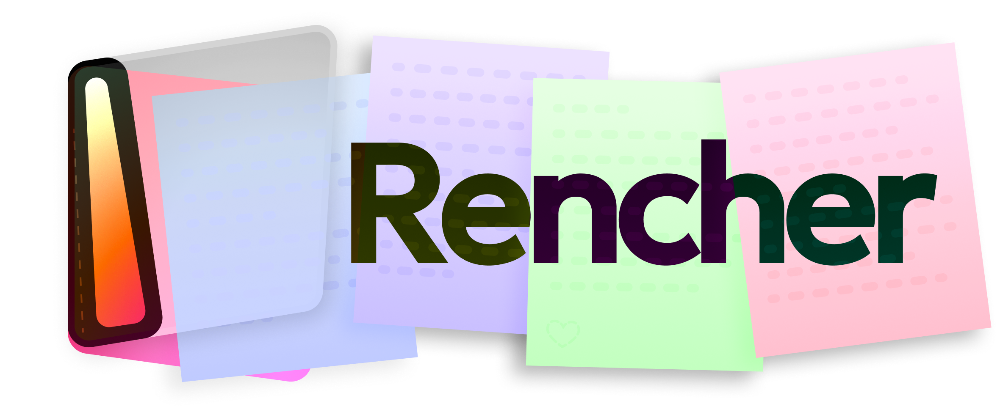

# Rencher

	

	Rencher is a manager for Ren'Py games, designed for DDLC mods
	
	it has support for Ren'Py 7 DDLC mods, and also fixes many bugs when trying to launch mods on Linux

main features:
<ul>
	<li>clean UI made with GTK4 and Adwaita</li>
	<li>asynchronous importing and deleting</li>
	<li>Discord RPC</li>
	<li>the ability to skip the splash screen and/or main menu</li>
	<li>self contained game saves</li>
</ul>

[link to the Trello board](https://trello.com/b/CGaqf0xx/rencher)
 

	
	

## download!
### [Windows](https://github.com/danatationn/Rencher/releases/latest/download/RencherInstaller.exe) - [Linux](https://github.com/danatationn/Rencher/releases/latest/download/Rencher.flatpak) - ~~macOS~~ (soon)

## upcoming features
- [x] Discord RPC
- [ ] asset viewer (unrpa + unrpyc)
- [ ] store (vndb, itch.io, the old DDMC mod list thing)

## building
### Linux
1. `uv sync`
2. `meson setup build --prefix $(pwd)/build/root`
3. `ninja -C build install`

 
 Flatpak 

`flatpak-builder --install --user build/flatpak build-aux/flatpak/com.github.danatationn.rencher.yml`

* running the Flatpak

	`flatpak run com.github.danatationn.rencher`

* exporting as .flatpak	

	`flatpak build-bundle ~/.local/share/flatpak/repo build/Rencher.flatpak com.github.danatationn.rencher`

### Windows
* setting up the environment
	1. install [MSYS2](https://www.msys2.org/)
	2. launch MSYS2 UCRT64
	3. `pacman -Sy mingw-w64-ucrt-x86_64-python mingw-w64-ucrt-x86_64-python-pip mingw-w64-ucrt-x86_64-uv mingw-w64-ucrt-x86_64-meson mingw-w64-ucrt-x86_64-gtk4 mingw-w64-ucrt-x86_64-gobject-introspection mingw-w64-ucrt-x86_64-libadwaita mingw-w64-ucrt-x86_64-blueprint-compiler mingw-w64-ucrt-x86_64-cmake mingw-w64-ucrt-x86_64-gcc mingw-w64-ucrt-x86_64-python-cx-freeze mingw-w64-ucrt-x86_64-nsis`
	4. `git clone https://github.com/danatationn/rencher`
	5. `cd rencher`
	6. `uv sync`
	7. `meson setup build --prefix $(pwd)/build/root`
	8. `ninja -C build install`

* freezing (Python to EXE)

	`ninja -C build freeze`

* making the installer

	`ninja -C build makensis`

### common steps

* running Rencher within Meson

	`ninja -C build run` or `ninja -C build dev` if you want debug logs

## credits and license

[Nicotine+](https://github.com/nicotine-plus/nicotine-plus) was used as reference for what I should do regarding PyGObject and packaging
 
logo made by [vl1](https://vl1.neocities.org/). check him out!
 
this project is under the [GPL-3](https://github.com/danatationn/rencher?tab=GPL-3.0-1-ov-file)

#### © 2026 danatationn
